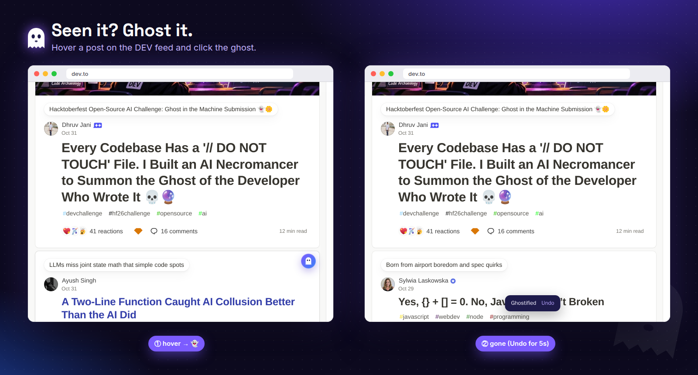
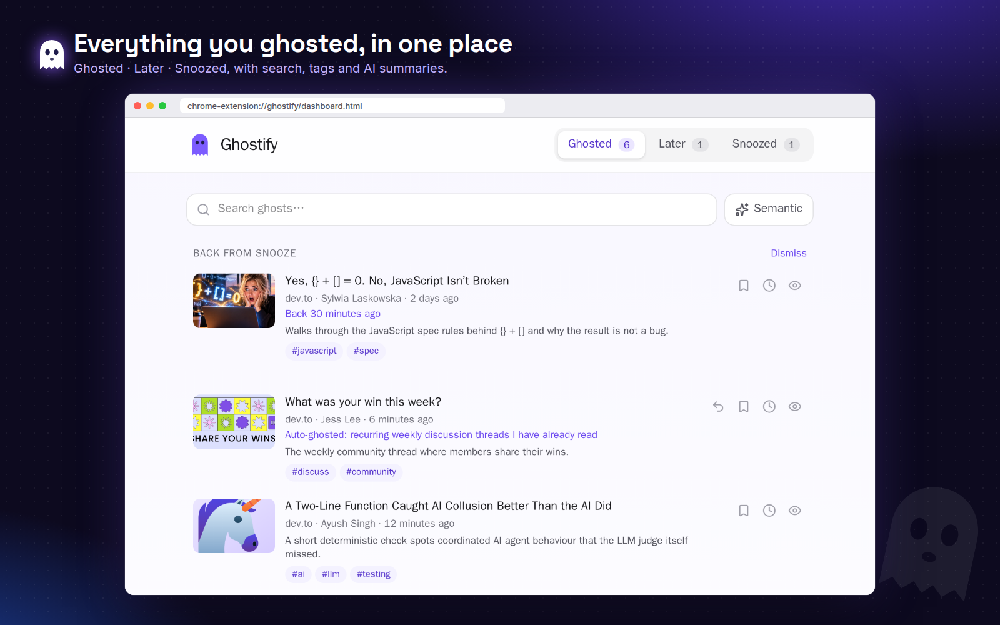
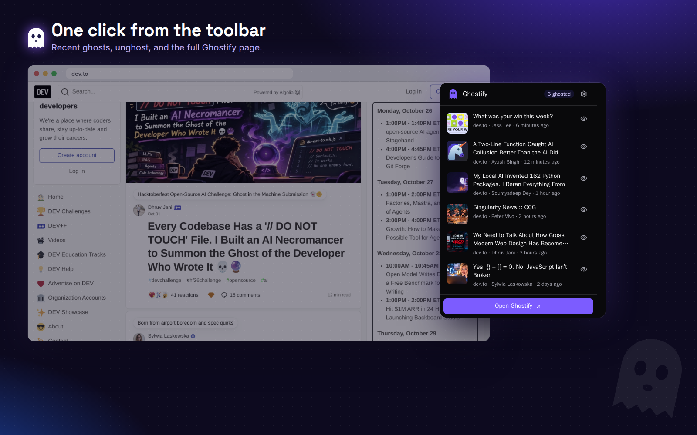
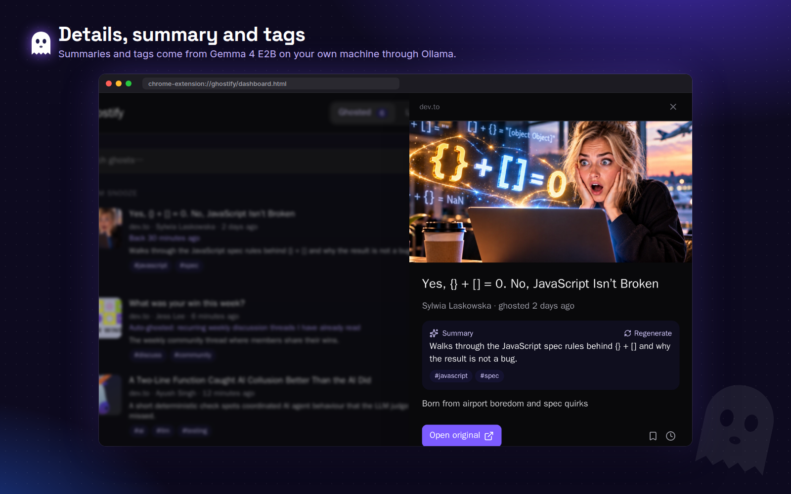
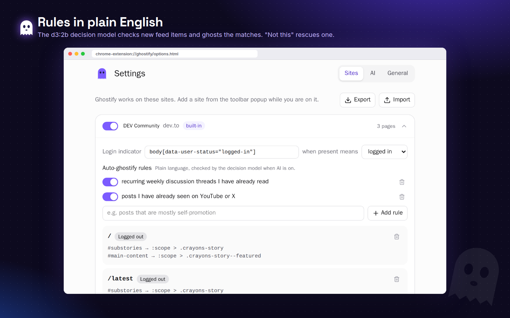
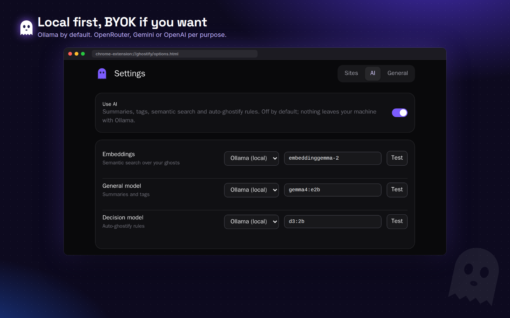

*This is a submission for the [Hacktoberfest Open-Source AI Challenge Week 4: Ghost in the Machine](https://dev.to/challenges/hacktoberfest-week4-2026-10-26)*

---

> TL;DR: I keep seeing the same posts on most of the DEV home feed tabs: **`Discover`**, **`Following`** and **`Curated`**.
>
> Wanted to fix it by implementing a simple **Mark as Seen** browser extension. Then one thing led to another, and I ended up building three projects: [one already abandoned](https://github.com/SweaDev/myDEV), and two ongoing ([Feedgrab](https://github.com/SweaDev/feedgrab) & [Ghostify](https://github.com/SweaDev/ghostify)).
>
> ***Note for users:*** This is still under development, so if you see errors, please look for updates: https://github.com/SweaDev/ghostify/releases
> 
> ***Note for judges:*** [v1.0.0](https://github.com/SweaDev/ghostify/releases/tag/v1.0.0) was completed within the submission period; later releases are updates. 

## Backstory

These days, I spend too much time on DEV.

- Deleted my old X/Twitter account because it gives me a headache! Created a new one only as a placeholder.
- Deactivated my Facebook account, because it's… well, that's a story for another day!

So most of the time I spend online is here on DEV and YouTube.

But the problem with DEV (and YouTube too) is that I keep seeing the same posts in the feed!

Open DEV in the morning: there's that post. Open it at lunch: there it is again. Open it at night: guess who's back! I've read it. I've reacted to it. I may have even commented on it. Still there, staring at me like it hasn't been introduced yet.

So on October 26, I did what any sane developer would do: I opened my editor instead of closing the tab.

### Attempt #1: myDEV (RIP 🪦)

The plan was simple:

- Put a ✓ button on every post card, right next to Bookmark.
- Click it, and the post disappears from the feed and goes into a new **myDEV** tab.
- Done. Go back to reading.

And it worked! For about an hour. Then I opened YouTube and saw the same video for the 14th time this week, and realized myDEV only knew how to read *one* site, with selectors I hard-coded by hand. The moment DEV changes a class name, it's dead. And for YouTube, I'd have to start over.

It took me a few days to admit it, but today I finally archived it. Rest in peace, myDEV. You were too specific for this world.

### Attempt #2: Feedgrab

What I actually needed wasn't a DEV plugin. I needed something that could look at *any* page and say: "this is a feed, these are the items, and this one is the same item you saw before, even after infinite scroll re-rendered it."

That became [Feedgrab](https://github.com/SweaDev/feedgrab), a TypeScript library that:

- **detects** feeds on a page (structural heuristics, optionally refined by an LLM), or takes CSS/XPath selectors you type;
- lets you **confirm or fix** its guesses in a Shadow DOM overlay;
- turns the feed into one **de-duplicated stream** of items that keeps up with infinite scroll;
- never removes anything unless you ask it to.

It runs in browser extensions, headless browsers and on the server, with the same API.

### Attempt #3: Ghostify

And then, finally, the thing I wanted in the first place. On top of Feedgrab. With a ghost. 👻

## What I Built

**Ghostify** is a browser extension (Chrome + Firefox) for feeds that keep showing you the same posts.

Hover a post, click the ghost, and it's gone from the feed. For good. Reload, scroll, come back tomorrow: it stays gone.

But it's not *deleted*. It becomes a ghost. Ghostify keeps a copy, so you can find it again, read it later, or snooze it until the weekend.



That's my take on **Ghost in the Machine**: the posts you've already seen don't die, they just stop haunting your feed and move into the machine. Quietly. Politely. Until you call them back.

What it does:

- **The ghost button** shows up on the post under your pointer. Click it, the post vanishes, and an **Undo** toast gives you 5 seconds of regret.
- **The Ghostify page** keeps everything in three tabs: **Ghosted**, **Later** and **Snoozed**.
- **Snooze** a post until later today, tomorrow, the weekend, next week, or any date. When time's up, it shows up in **Back from snooze**.
- **Search** your ghosts by keyword, or switch on **Semantic** and just describe what you remember ("that post about JavaScript adding objects and arrays").
- **Auto-ghostify rules** in plain English, per site: "recurring weekly discussion threads I have already read". A local decision model checks new feed items against them and ghosts the matches. If it gets one wrong, **Not this** brings the post back, and that rule never touches it again.
- **Add any site.** On any page with a feed, click **Add this site**. Feedgrab proposes the feeds, you confirm them in its overlay, and choose whether they're for the logged-in or logged-out view.
- **New tab flavor**, if you want your ghosts on every new tab.



## Demo

No store listing (yet!), so the demo is: install it, open DEV, start ghosting. It takes about a minute:

1. Download a zip from [Releases](https://github.com/SweaDev/ghostify/releases): `ghostify-<version>-chrome.zip` or `ghostify-<version>-firefox.zip`.
2. **Chrome**: unzip, open `chrome://extensions`, turn on **Developer mode**, click **Load unpacked**.
   **Firefox**: open `about:debugging#/runtime/this-firefox`, click **Load Temporary Add-on…** and pick the zip.
3. Open <https://dev.to/> logged out, hover a post, click the ghost.

Here's a quick tour. *(The screenshots represent what a user would see.)*

The toolbar popup lists your recent ghosts. Click the 👁 to unghost one, and it shows up in the feed again:



Click a ghost to see its details, the AI summary and tags:



Write auto-ghostify rules in plain English, per site:



And pick a model for each job:



## Code





## How I Built It

### The open-source AI part

AI is **optional and off by default**. Ghostify is perfectly happy as a dumb "hide this post" button. Turn AI on, and it gets three jobs, each with its own model:

| Job | Default (local, via Ollama) | Used for |
|---|---|---|
| Embeddings | [`embeddinggemma-2`](https://ollama.com/library/embeddinggemma-2) | Semantic search over your ghosts |
| General | [`gemma4:e2b`](https://ollama.com/library/gemma4) | Summaries and tags for each ghosted post |
| Decision | [`d3:2b`](https://ollama.com/library/d3) | Checking new feed items against your auto-ghostify rules |

All three are open-weight and small enough to run on a laptop. Start Ollama so it accepts requests from extensions, and that's it:

```sh
ollama pull embeddinggemma-2
ollama pull gemma4:e2b
ollama pull d3:2b
OLLAMA_ORIGINS="chrome-extension://*,moz-extension://*" ollama serve
```

If you'd rather use a hosted model, every job can switch to **OpenRouter**, **Gemini** or **OpenAI** with your own key. The plumbing is the [AI SDK](https://ai-sdk.dev/), so swapping providers is a dropdown, not a rewrite.

A few things I'm happy about:

- **Fallbacks everywhere.** If the decision model is down, the general model handles the rule check. If embeddings fail, search falls back to keywords. Nothing breaks because Ollama isn't running.
- **Embeddings are tagged with the model that made them.** Change the embedding model and Ghostify ignores the old vectors instead of mixing them up. **Reindex** fills the gaps.
- **One honest gap:** `d3`'s response format isn't documented (yet). Ghostify reads the shapes it knows, treats anything else as "no match", and logs it. Better to miss a ghost than to hide something you wanted to see!

### The extension part

- **[WXT](https://wxt.dev/)** for one codebase that builds Chrome MV3 and Firefox, plus the new-tab flavor.
- **React 19 + Tailwind v4** for the popup, the Ghostify page and settings.
- **Dexie** (IndexedDB) for ghosts, embeddings and keys. Everything stays in your browser. No account, no sync, no server.
- **Feedgrab** for finding feeds and items, and for hiding them. Ghostify never touches a feed node itself; it asks Feedgrab's `removeItem` to hide it, and its own UI lives in a separate Shadow DOM.

Security was a bit of a rabbit hole:

- **Content scripts never see API keys.** They don't even open IndexedDB. Everything goes through typed messages to the background script, and the background talks to the model.
- Keys aren't in `storage.local` either, because content scripts can read that. They live in a Dexie table on the extension's own origin.
- In content scripts, Feedgrab gets a proxy instead of a model, which also shrank the bundle from **380 KB to 71 KB**. Nice side effect!

### The "how did you build all this in a week" part

I didn't write most of the code by hand. I used a coding agent.

But I didn't just say "build me an extension" either. I've been using a small spec-driven flow I call **specx**:

1. **Spec**: I wrote the [spec](https://github.com/SweaDev/ghostify/blob/main/specs/SPEC-v1.md) by hand. It's 17 lines. Literally a paragraph and a list of features.
2. **Plan**: the agent turned it into a [plan](https://github.com/SweaDev/ghostify/blob/main/specs/PLAN-v1.md) with the stack, architecture and a **Decisions** log.
3. **Tasks**: then into [23 tasks](https://github.com/SweaDev/ghostify/blob/main/specs/TASKS-v1.md) across 4 phases, each with the spec/plan line ranges it needs, the files it touches, and a **Done** check.
4. **Build loop**: take the first unblocked task, read only what it references, implement it, run its Done check plus lint + typecheck + tests, tick the box, commit. Repeat.
5. **Phase check**: at the end of each phase, follow the README from a clean state, build, load it in the browser, fix what's broken, tag a release.

The rules live in [`AGENTS.md`](https://github.com/SweaDev/ghostify/blob/main/AGENTS.md), so any agent can pick it up. Every judgment call goes into the plan's Decisions log, so I can see *why* something was done the way it was. And there's one commit per task, so `git log` reads like a changelog.

Phase 1 was "ghost a post on DEV". Phase 4 was "auto-ghostify with local AI". Each phase ended with something I could actually load and use, not a pile of half-wired modules.

## Why Does Open Innovation Matter?

Because **the thing Ghostify reads is my browsing**.

Think about what an AI feature in a feed extension actually sees: every post on every feed you scroll, what you hide, what you save for later, what you search for. That's a pretty detailed picture of a person. I don't want that going to anyone's API by default. Not even mine.

With open-weight models, it doesn't have to:

- **Gemma 4 E2B, EmbeddingGemma 2 and d3:2b run on my laptop.** Summaries, tags, semantic search and the rule checks all happen locally. With Ollama, nothing leaves the machine.
- **It costs nothing per post.** Auto-ghostify checks *every new item in the feed*. With a paid API, that's a meter running every time I scroll. Locally, it's just my fan spinning a bit.
- **It keeps working.** No rate limits, no deprecation emails, no "this model will be retired on…".
- **A small, specialized model is enough.** I don't need a giant model to answer "is this a weekly discussion thread?" A 2B decision model is the right size for the job, and I could only pick it because it's open.

And it's not just the models. Ghostify is built on open source all the way down: WXT, React, Dexie, the AI SDK, Biome, Vitest… and Feedgrab, which I split out *because* I wanted it to be reusable. If someone wants to build a "hide the reruns" extension for YouTube, or a feed reader for a site that doesn't have RSS, the hard part is already there. MIT licensed. Go for it.

A closed API would have given me a smarter summary, maybe. Open models gave me a tool I'm actually comfortable running on everything I read.

## My Agent Session

The whole project was built in agent sessions, following the specx flow above. The best way to see them is the commit history: one commit per task, from `Scaffold WXT React project` to `Add auto-ghostify rules with rescue`.

## The Spirit of It

I keep thinking about the name.

Most "hide this" features are really "delete this". You click, it's gone, and you'll never find it again. That always felt a bit wrong to me. I *did* read that post. Some of them were good! I just don't need to see them every time I open the home page.

So in Ghostify, nothing dies. It becomes a ghost. It stays in the machine, with its title, its author, a little summary, and a few tags, waiting until you call it back. A bit like Día de los Muertos for posts: not here anymore, but not forgotten either.

And somewhere in an archived repo, myDEV is resting peacefully, knowing it started all of this. 🕯️

## Prize Categories

- **Best Use of Gemma**: Ghostify uses **Gemma 4 E2B** (`gemma4:e2b`) for summaries and tags, and **EmbeddingGemma 2** (`embeddinggemma-2`) for semantic search, both running locally through Ollama by default.

Thanks for reading! And if a post of yours disappears from my feed, don't take it personally. It just means I've already read it. 👻
